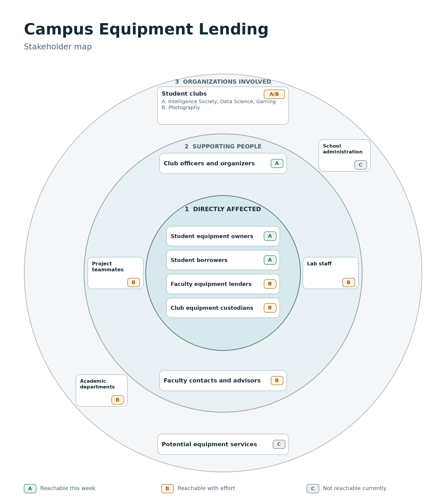

# Campus Equipment Lending

A product design project exploring how students and educators share technology equipment for coursework and campus activities.

**Live link:** To be added.

## Team

- Harvey Rayhanson Chowdhury

## Problem

Students and club officers sometimes do not know who has borrowed equipment, whether it is still being used, or when it will return. Loans are often arranged informally, and officers may not know what another officer has lent. This can lead to extra searching and follow-up, even when equipment is eventually returned.

## Research

### People and access

### Interviews

[Interview script](docs/interview_script.md)

Three participants from Data Science Club were interviewed together over Zoom on November 10, 2026. Each file records the participant’s perspective and identifies shared answers.

| Participant | Role | Experience |
| --- | --- | --- |
| [P1](docs/P1_2026-11-10.md) | President | Lending an ESP board and arranging a laptop loan |
| [P2](docs/P2_2026-11-10.md) | Treasurer | Keeping officers informed about equipment loans |
| [P3](docs/P3_2026-11-10.md) | Member | Borrowing and returning a laptop for a data science project |
