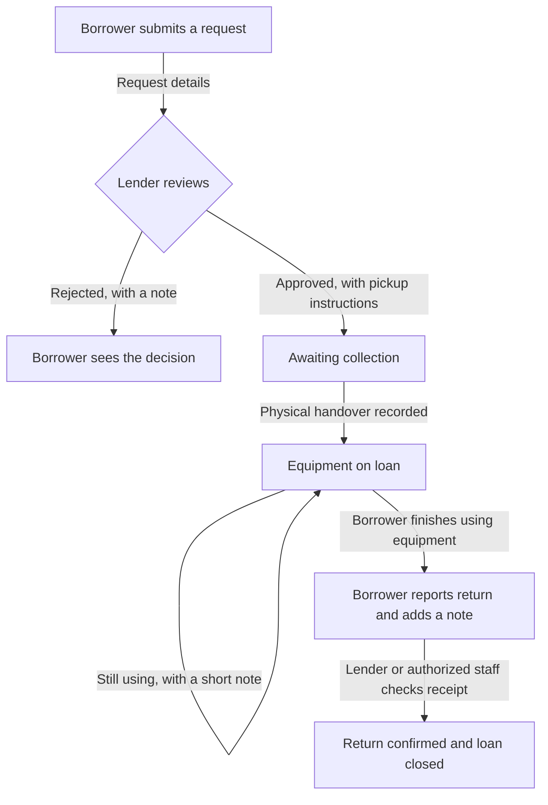
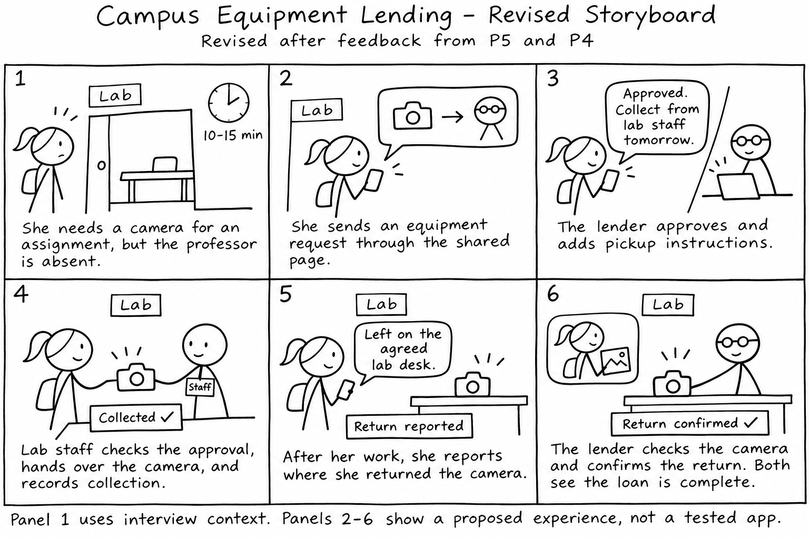
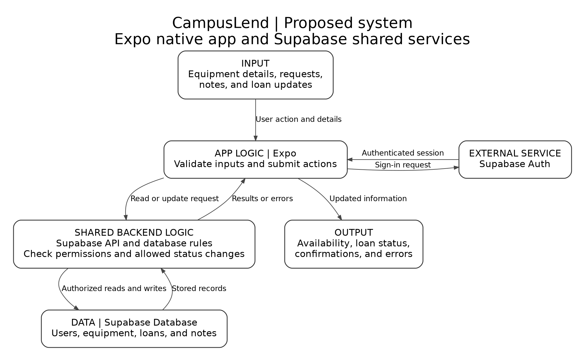

# CampusLend

Request campus equipment, coordinate pickup, and keep loan status clear.

**MTEC3200 Project 2 · Solo project by Harvey Rayhanson Chowdhury**

**Platform:** Expo / React Native, with Supabase for shared storage and authentication.  
**Stage:** Research and design. Native implementation has not started.  
**Demo:** Expo Go link and screen recording will be added after implementation.

CampusLend is the working product name. Earlier research and sketches use **Campus Equipment Lending**.

## The problem

Students and campus equipment lenders sometimes have difficulty coordinating access and establishing who currently holds an item because requests and loan information depend on individual availability, memory, and scattered records. This can lead to searching, waiting, or additional follow-up, even when equipment is eventually returned.

Successful informal loans are part of the evidence. The aim is to make coordination clearer while preserving the trust and flexible arrangements that already work.

**How might we help students and campus equipment lenders coordinate access and understand current loan status while preserving the ease and flexibility of informal borrowing?**

[Research synthesis](docs/synthesis.md)

## What we are designing

CampusLend is a native app where students request equipment and campus lenders coordinate loans. Its core function is to keep requests, current loan status, and return updates visible to the people involved while allowing flexible borrowing arrangements.

| Person | Planned actions |
| --- | --- |
| Borrower | Find offered equipment, request it, read pickup instructions, and report a return |
| Lender | Add equipment and availability, approve or reject requests, add notes, and confirm returns |
| Authorized staff | Check an approval, record a physical handover, and confirm receipt when authorized by the lender |

Lenders enter their own equipment. Supabase will hold the shared records so updates can reach the people involved across devices.

## Planned borrowing workflow

Approval and collection are separate. A reported return remains pending until receipt is confirmed. Return timing can be a specific agreement or a flexible arrangement. The app does not introduce universal penalties or lending deadlines.

The MVP covers equipment listings, requests, decisions, short notes, collection records, return reporting, and shared loan status. [Full MVP scope](docs/mvp.md)

## Storyboard

The first panel begins with P5's camera-access difficulty. The later panels show a proposed experience, rather than an event that happened or a tested app.

Feedback from P5 and P4 led to clearer pickup arrangements, staff-assisted handover, and short pickup and return notes. P5's note-section suggestion followed a question from the interviewer.

[Initial storyboard](docs/storyboard-initial.png) · [Feedback and documented changes](docs/storyboard-feedback.md)

## Planned system

The Expo app will submit signed-in actions to Supabase. Backend rules will check access and allowed status changes before shared records are updated. The app will show saved results, empty states, and errors.

[System diagram source](docs/system-diagram.mmd) · [Platform decision](docs/platform-decision.md)

This diagrams our proposed product. The [Snipe-IT analysis](docs/comparative-analysis.md) is a separate study of an existing product.

## Research foundation

Seven participants were interviewed, six outside my social circle. P1-P3 took part in a shared Zoom discussion on November 10, 2026. P4-P7 were interviewed individually in person on November 11, 2026. Shared incidents are counted once.

| Participant | Role | Experience |
| --- | --- | --- |
| [P1](docs/P1_2026-11-10.md) | Data Science Club president | Lending an ESP board and arranging a laptop loan |
| [P2](docs/P2_2026-11-10.md) | Data Science Club treasurer | Equipment visibility between officers |
| [P3](docs/P3_2026-11-10.md) | Data Science Club member | Borrowing and returning a laptop |
| [P4](docs/P4_2026-11-11.md) | Faculty and lab lender | Same-day laptop loan and personal notes |
| [P5](docs/P5_2026-11-11.md) | Photography Club student | Camera borrowing and access to the lender |
| [P6](docs/P6_2026-11-11.md) | Gaming Club manager | Informal sharing through Discord and in person |
| [P7](docs/P7_2026-11-11.md) | Student borrower | Webcam and keyboard loan for a hand-tracking project |

The journey map follows P5's delayed request. It is separate from her successful same-day camera loan.

## Project documents

| Area | Materials |
| --- | --- |
| Research preparation | [Stakeholder map](docs/stakeholder_map.png), [interview script](docs/interview_script.md) |
| Synthesis | [Affinity wall](docs/affinity-wall.png), [journey map](docs/journey-map.png), [synthesis and HMW](docs/synthesis.md) |
| Comparison | [Discord, Cheqroom, and Snipe-IT](docs/comparative-analysis.md), [existing-product diagram](docs/existing-product-system-diagram.png) |
| Ideation | [Eight-idea sheet](docs/crazy-8s.png), [concept selection](docs/ideation.md) |
| Design | [Storyboard](docs/storyboard.png), [feedback and revisions](docs/storyboard-feedback.md), [MVP](docs/mvp.md) |
| Platform and architecture | [Platform decision](docs/platform-decision.md), [proposed-product diagram](docs/system-diagram.png) |
| Process | [Prompting log](docs/prompting-log.md) |
