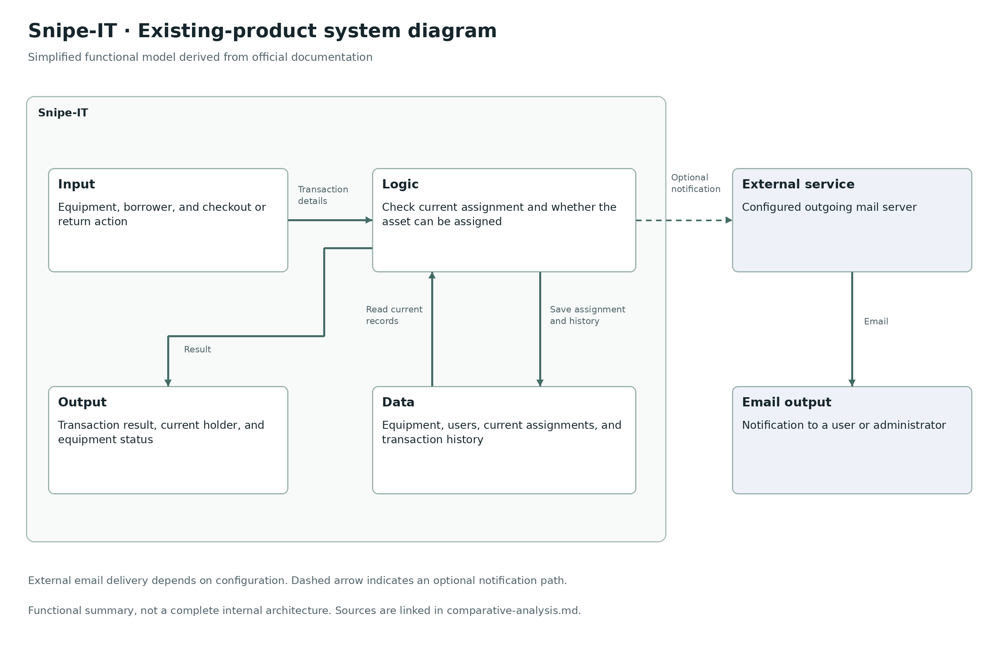

# Comparative Analysis

Discord was mentioned by P6. Cheqroom and Snipe-IT were researched through official documentation, not tested by these participants. Potential mismatches below are design judgments. Product information checked November 11, 2026.

| Product | What it does well | How it does not fit participants | Worth borrowing |
| --- | --- | --- | --- |
| Discord | Already used by P6’s club. Searchable message history helps retrieve earlier requests. [1] | In P6’s actual arrangement, requests appear in chat but handovers and returns are not confirmed. The messages therefore provide an incomplete loan history. This does not establish a limit on every possible Discord setup. | Keep requests close to members’ existing communication and make earlier conversations easy to find. |
| Cheqroom | Provides equipment browsing, reservation requests, and separate checkout and return records. [2][3] | Potential mismatch: accounts, configured inventory, and date-based booking may add effort to the casual arrangements P4 and P6 value. Participants have not tested it. | Distinguish requesting equipment from receiving it, show availability, and record returns clearly. |
| Snipe-IT | Shows assigned equipment, its holder, and history. An assigned asset cannot be checked out again until checked in. [4][5] | Potential mismatch: maintaining an asset registry and recording transactions may require more administration than P4’s notes or P6’s friendly exchanges. Participants have not tested it. | Make the current holder visible and preserve handover and return history. |

## Existing-Product System Diagram: Snipe-IT

This is a simplified functional model derived from documentation, not a complete internal architecture. The input is a checkout or return action with equipment and borrower details. Logic checks the asset’s assignment and status, records the transaction, and shows the resulting holder and status. A configured mail server can deliver notifications. [4][5][6]

## Sources

1. [Discord: How to Use Search](https://support.discord.com/hc/en-us/articles/115000468588-How-to-Use-Search-on-Discord)
2. [Cheqroom: Reservations in the Booking Portal](https://knowledge.cheqroom.com/helpcenter/how-to-make-reservations-in-the-booking-portal)
3. [Cheqroom: Check-outs and Check-ins](https://knowledge.cheqroom.com/helpcenter/how-to-create-and-manage-check-outs-and-check-ins)
4. [Snipe-IT: Overview](https://snipe-it.readme.io/docs/overview)
5. [Snipe-IT: Product Features](https://snipeitapp.com/product)
6. [Snipe-IT: Configuration](https://snipe-it.readme.io/docs/configuration)
