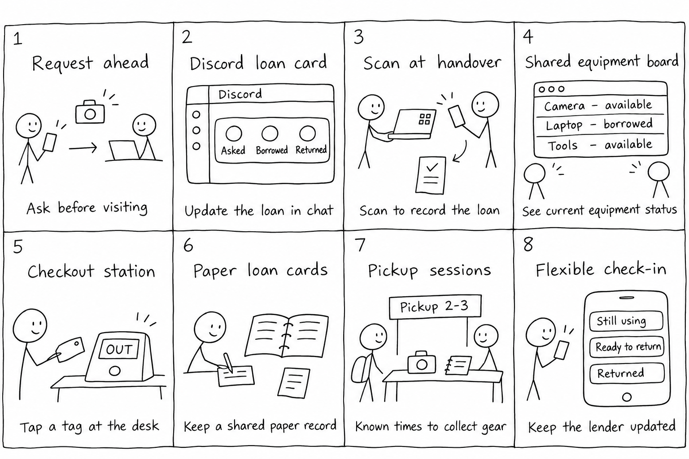

# Ideation and Concept Selection

## Research check-in

The final interviews broadened the synthesis beyond tracking returns. P5 described difficulty reaching a lender, while P7 independently suggested requesting equipment before visiting. Successful loans from P3, P4, P5, and P7 also showed why flexible arrangements should be preserved.

## How Might We

How might we help students and campus equipment lenders coordinate access and understand current loan status while preserving the ease and flexibility of informal borrowing?

## Eight ideas

| Idea | Approach |
| --- | --- |
| 1. Request ahead | Send a request before visiting and receive a pickup arrangement |
| 2. Discord loan card | Add loan status updates to the group's existing chat |
| 3. Scan at handover | Scan an equipment tag to create a short shared loan receipt |
| 4. Shared equipment board | Let authorized people see current availability and loan status |
| 5. Checkout station | Use a physical desk device to record equipment-tag interactions |
| 6. Paper loan cards | Keep a shared binder record and a matching borrower receipt |
| 7. Pickup sessions | Offer known collection times with a shared loan register |
| 8. Flexible check-in | Report ongoing use, readiness to return, or a return update |

The sheet is an AI-generated exploration of the eight ideas. No timed sketch session is claimed.

## Selection

I showed the sheet to classmates. Their feedback favored combining ideas 1, 4, and 8, matching my preference. This is a summary from recollection, not a recorded vote or direct quotation.

The selected direction connects advance requests, shared loan status, and flexible updates in one borrowing flow. The other ideas remain alternatives rather than additional MVP features.

## Concept

CampusLend is a native app where students request equipment and campus lenders coordinate loans. Its core function is to keep requests, current loan status, and return updates visible to the people involved while allowing flexible borrowing arrangements.
